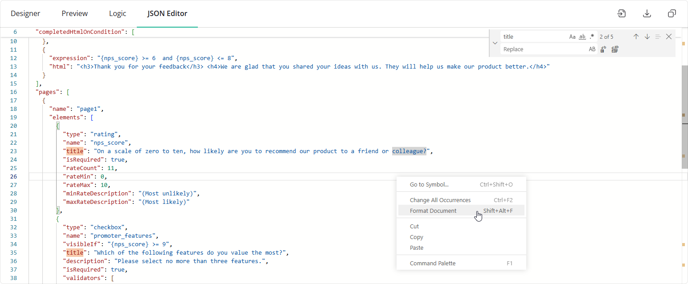
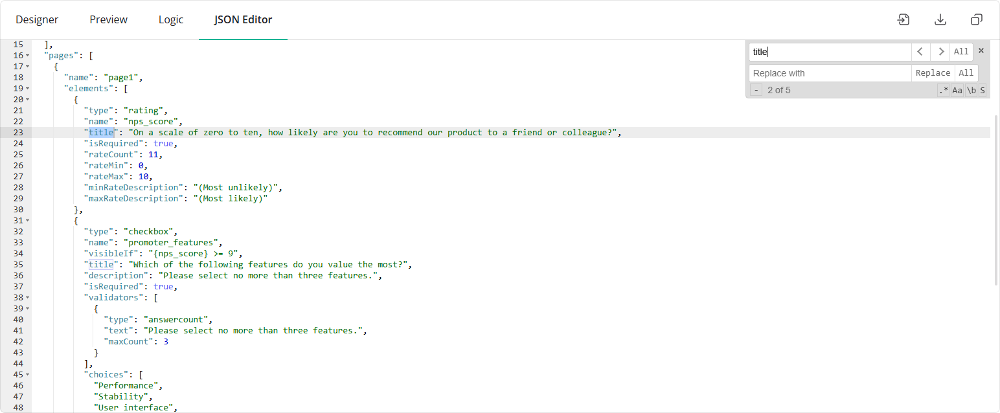

# Integrate Third-Party JSON Editors

The [JSON Editor tab](/survey-creator/documentation/end-user-guide/user-interface#json-editor-tab) enables users to edit survey JSON schemas as text. By default, it contains a plain text area. You can integrate [Monaco](https://microsoft.github.io/monaco-editor/) or [Ace](https://ace.c9.io/) to add syntax highlighting, code folding, find and replace, and other code editing features.

## Integrate Monaco

[Monaco Editor](https://microsoft.github.io/monaco-editor/) is the code editor that powers Visual Studio Code. It is open-source and distributed under the [MIT license](https://github.com/microsoft/monaco-editor/blob/main/LICENSE.txt).



Monaco provides the following features in the JSON Editor tab:

- Syntax highlighting
- Bracket matching
- Code folding
- Find and replace
- JSON formatting through **Format Document** in the context menu
- Underlined errors with messages on hover
- Automatic dark theme when Survey Creator uses a dark color palette

> Monaco integration requires Survey Creator v3.2.6 or newer.

[Demo: Integrate Monaco Editor into Survey Creator](/survey-creator/examples/monaco-editor-integration/ (linkStyle))

### Modular Applications

Install the [`monaco-editor`](https://www.npmjs.com/package/monaco-editor) package:

```sh
npm install monaco-editor
```

Import Monaco and expose it as `window.monaco` before you create a Survey Creator instance. The following code uses `Object.assign()` so that it also works in TypeScript without adding a declaration for `window.monaco`:

```js
import * as monaco from "monaco-editor";
import { SurveyCreatorModel } from "survey-creator-core";

Object.assign(window, { monaco });

const creator = new SurveyCreatorModel();
```

Place the setup in the component or module that initializes Survey Creator. If your application uses server-side rendering (SSR), disable SSR for the component that imports Monaco and renders Survey Creator.

### Classic Script Applications

Install the [`monaco-editor`](https://www.npmjs.com/package/monaco-editor) package:

```sh
npm install monaco-editor
```

If your application loads dependencies with classic `<script>` tags, bundle Monaco's ESM build separately. Create an entry module that imports Monaco and exposes it as `window.monaco`:

```js
import * as monaco from "monaco-editor";

Object.assign(window, { monaco });
```

Add the worker setup described below to this module and use a bundler to generate a browser script. Load the generated script before the code that creates a Survey Creator instance:

```html
<script src="/js/monaco.bundle.js"></script>
<script>
  const creator = new SurveyCreatorCore.SurveyCreatorModel();
</script>
```

Only the Monaco setup needs to be bundled. The rest of your application can continue to use classic scripts.

### Configure Monaco Workers

Monaco uses web workers for JSON diagnostics, completion, and hover information. For the JSON Editor tab, configure the following workers before creating a Survey Creator instance:

- JSON worker
- Base editor worker

Follow the instructions for your bundler in the [Monaco ESM integration guide](https://github.com/microsoft/monaco-editor/blob/main/docs/integrate-esm.md) or use the following demo as a reference:

[Demo: Integrate Monaco Editor into Survey Creator](/survey-creator/examples/monaco-editor-integration/ (linkStyle))

## Integrate Ace

[Ace](https://ace.c9.io/) is an embeddable code editor with support for extensions. It is open-source and distributed under the [BSD license](https://github.com/ajaxorg/ace/blob/master/LICENSE).



Ace provides the following features in the JSON Editor tab:

- Syntax highlighting
- Bracket matching
- Code folding
- Find and replace
- Error annotations with messages on hover
- Automatic dark theme when Survey Creator uses a dark color palette

[Demo: Integrate Ace Editor into Survey Creator](/survey-creator/examples/ace-editor-integration/ (linkStyle))

### Modular Applications

Install the [`ace-builds`](https://www.npmjs.com/package/ace-builds) package:

```sh
npm install ace-builds
```

Import Ace and the extensions that enable the Find/Replace dialog and support Survey Creator's dark color palette. Set the resource path before creating a Survey Creator instance:

```js
import "ace-builds/src-noconflict/ace";
import "ace-builds/src-noconflict/ext-searchbox";
import "ace-builds/src-noconflict/theme-clouds_midnight";
import { AceJsonEditorModel, SurveyCreatorModel } from "survey-creator-core";

AceJsonEditorModel.aceBasePath = "https://unpkg.com/ace-builds/src-min-noconflict/";

const creator = new SurveyCreatorModel();
```

[Demo: Integrate Ace Editor into Survey Creator](/survey-creator/examples/ace-editor-integration/ (linkStyle))

### Classic Script Applications

Add Ace and its extensions to your HTML page:

```html
<script src="https://unpkg.com/ace-builds/src-min-noconflict/ace.js"></script>
<script src="https://unpkg.com/ace-builds/src-min-noconflict/ext-searchbox.js"></script>
<script src="https://unpkg.com/ace-builds/src-min-noconflict/theme-clouds_midnight.js"></script>
```

Set the Ace resource path, then create a Survey Creator instance:

```js
SurveyCreatorCore.AceJsonEditorModel.aceBasePath = "https://unpkg.com/ace-builds/src-min-noconflict/";

const creator = new SurveyCreatorCore.SurveyCreatorModel();
```

[Demo: Integrate Ace Editor into Survey Creator](/survey-creator/examples/ace-editor-integration/ (linkStyle))
