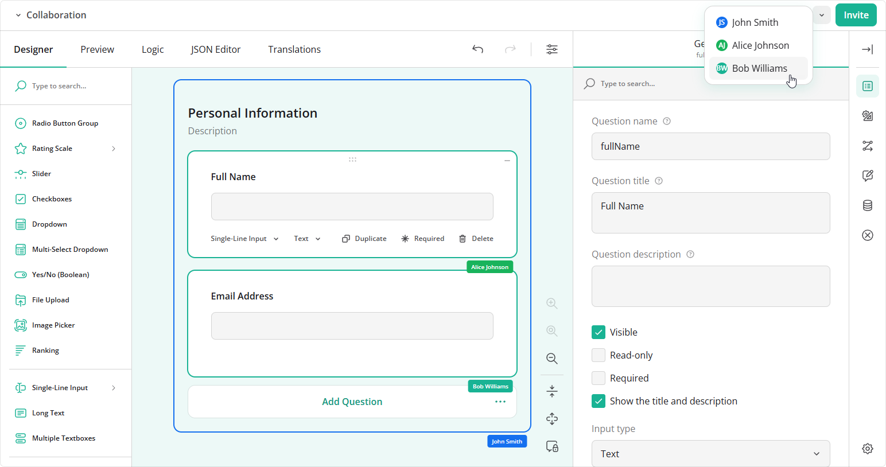

# Collaborative Form Editing

Collaborative form editing enables multiple authors to design and modify the same form at the same time. Each author opens a local Survey Creator instance connected to a shared room. Changes to questions, choices, and form settings are sent to the other authors, while presence indicators show participants' selections, focused fields, and cursors.



Survey Creator provides a `CollaborationPlugin` that records edits, applies incoming changes, and displays collaboration controls. Your application supplies the connection and server that exchange updates between authors.

[Demo: Collaborative Form Editing](/survey-creator/examples/collaborative-survey-creator/ (linkStyle))

## Use Cases

Collaborative form editing is useful when several authors contribute to one form definition:

- Team form design      
A form designer builds the layout while a subject matter expert writes questions and answer choices.

- Content and logic reviews       
Authors review wording, validation, and conditional logic together and immediately see each other's changes.

- Multilingual authoring        
Authors work together on a form's source text and translations.

The shared result is a SurveyJS JSON form definition. For participants who need to answer an existing form together, see the following help topic:

[Documentation: Collaborative Form Filling](/form-library/documentation/multi-user-form-filling (linkStyle))

## Setup Instructions

### Run the Reference Application

The [Collaborative Form Editing repository](https://github.com/surveyjs/collaborative-form-editing) contains a Node.js WebSocket server and React, Angular, Vue 3, and vanilla JavaScript clients. Participants using different clients can join the same room.

1. Clone the repository:
   ```sh
   git clone https://github.com/surveyjs/collaborative-form-editing.git
   cd collaborative-form-editing
   ```
2. Install dependencies and start the application:
   ```sh
   npm install
   npm start
   ```
3. Open `http://localhost:8080`. In the lobby, select a framework, enter your display name, and create a room with a room ID. Use an empty form or supply an initial survey JSON schema.
4. Click **Invite** and open the copied link in another browser tab, browser, or device that can reach the server. Join the same room and add a question or edit its title to verify that both editors receive the change.
 
A `localhost` link works only on the device running the server; use a reachable server address when inviting participants on other devices.

> Survey Creator and its collaboration feature require [commercial licenses](/pricing) for production use. A Survey Creator license alone does not activate the collaboration license. The reference application reads `SURVEYJS_LICENSE_KEY` from its root `.env` file or an environment variable. Configure the key before running the build. See [license activation instructions](/remove-alert-banner).

### Connect Survey Creator in Your Application

Import `CollaborationPlugin` from `survey-creator-core/collaboration` and include the Form Library, Survey Creator, and collaboration stylesheets. Register the plugin on the Survey Creator instance using the `addPlugin` method before connecting it to the room.

The plugin does not open a network connection itself. Its `onRecordAdded` and `onRecordChanged` events produce outgoing edit records, and its `apply(record)` method applies incoming records without echoing them as local edits. Presence updates use separate events and methods.

The following code connects Survey Creator to a server using the reference application's transport helper. Copy [`shared/collab-client.ts`](https://github.com/surveyjs/collaborative-form-editing/blob/004f53b7818363905272fdfdffeb6092f24fb5d6/shared/collab-client.ts) and its [`server/protocol.ts`](https://github.com/surveyjs/collaborative-form-editing/blob/004f53b7818363905272fdfdffeb6092f24fb5d6/server/protocol.ts) type definitions into your application's source directory, preserving their relative paths. The helper is example app code and is not exported by a SurveyJS npm package. Here, `roomId`, `participantName`, and `inviteUrl` come from your application's room and participant management:

```ts
import { SurveyCreatorModel } from "survey-creator-core";
import { CollaborationPlugin } from "survey-creator-core/collaboration";
import { connectCollab } from "./shared/collab-client";
import "survey-core/survey-core.css";
import "survey-creator-core/survey-creator-core.css";
import "survey-creator-core/collaboration.css";

const creator = new SurveyCreatorModel();
const collab = new CollaborationPlugin(creator, {
  roomId,
  getInviteLink: () => inviteUrl,
});
creator.addPlugin("collaboration", collab);

const connection = connectCollab({
  creator,
  collab,
  roomId,
  name: participantName,
  onStatus: (status) => collab.setStatus(status),
  onHistoryChanged: (changes) => collab.setHistory(changes),
});

// Render Survey Creator with your framework's component.

// Call when the editor is removed from the page.
// connection.dispose();
// creator.dispose();
```

### Set Up the Server and Storage

Run the reference server or implement its [collaboration protocol](https://github.com/surveyjs/collaborative-form-editing/blob/004f53b7818363905272fdfdffeb6092f24fb5d6/PROTOCOL.md) in your preferred backend. For each room, the server stores an initial schema and an ordered log of edit records. It sends both to newcomers, appends incoming records, and broadcasts them to other authors in the room. The server treats records as opaque JSON and requires no SurveyJS dependency.

For production use, implement room access checks, persistent storage, and a workflow for publishing the completed form definition. Live synchronization does not save a form to your app's database automatically&mdash;use Survey Creator's save workflow to save `creator.JSON`:

[Documentation: Save and Load Survey Model Schemas](/survey-creator/documentation/get-started-react#save-and-load-survey-model-schemas (linkStyle))

## Limitations

Keep these limitations in mind when using the plugin and reference app:

- Competing changes       
Edits use last-write-wins with server-ordered records. There is no automatic merge of competing text edits or field locking. A later change to the same property can replace an earlier change.

- Temporary storage in the reference server         
Rooms and their record logs are stored in memory. A server restart clears them, and empty rooms are deleted after their configured lifetime. Add persistent storage if authors must return later.

- Offline changes         
The reference transport does not queue offline edits or automatically reconnect. After a dropped connection, rejoin the room to restore its shared state; edits made while disconnected are not sent to other authors.

- Local undo and redo       
Undo stacks belong to individual authors. Incoming changes are not added to another author's undo stack. Undo may have no effect if another author has deleted the affected element or overwritten its value. Applying a full form snapshot rebuilds the form and resets the receiving editor's undo history.

- Programmatic schema changes       
Assigning `creator.JSON` is not automatically recorded as an edit. Call `collab.snapshot()` after such changes if they must be shared. Full snapshots replace the form definition and can overwrite concurrent work.

- Access control        
The reference application has no authentication or room authorization. An invite link or room ID alone does not establish an author's permissions.

- Compatible editor configuration       
All clients must use compatible SurveyJS versions and register the custom properties and question types used by the shared form.

## See Also

- [Demo: Collaborative Form Editing](/survey-creator/examples/collaborative-survey-creator/)
- [Documentation: Collaborative Form Filling](/form-library/documentation/multi-user-form-filling)
- [Documentation: Integration with Backend](/survey-creator/documentation/integration-with-backend)
